# NEURAFLOK

<p align="center">
  
</p>

<p align="center"><strong>One workspace for AI conversations and local projects.</strong></p>
<p align="center">A local-first desktop app for working with AI providers, project files, and approved tools.</p>

<p align="center"><strong>Download NEURAFLOK</strong></p>

<table align="center">
  <tr>
    <td align="center" width="200">
      <br>
      <strong>Windows</strong><br>
      <sub>x64 · ARM64</sub><br><br>
      <a href="https://github.com/Marco260104/neuraflok/releases/latest/download/NEURAFLOK-Setup-x64.exe">Download installer</a>
    </td>
    <td align="center" width="200">
      <br>
      <strong>macOS</strong><br>
      <sub>Apple silicon · Intel</sub><br><br>
      <a href="https://github.com/Marco260104/neuraflok/releases/latest/download/NEURAFLOK-macOS-arm64.dmg">Download DMG</a>
    </td>
    <td align="center" width="200">
      <br>
      <strong>Linux</strong><br>
      <sub>x64 · ARM64</sub><br><br>
      <a href="https://github.com/Marco260104/neuraflok/releases/latest/download/NEURAFLOK-Linux-x64.AppImage">Download AppImage</a>
    </td>
  </tr>
</table>

<p align="center">Need another architecture or package format? <a href="https://github.com/Marco260104/neuraflok/releases/latest">Browse all downloads</a>.</p>

<p align="center">
  <a href="https://github.com/Marco260104/neuraflok">Source</a> ·
  <a href="https://t.me/neura_flok">Telegram community</a> ·
  <a href="https://github.com/Marco260104/neuraflok/releases">All releases</a> ·
  <a href="docs/setup.md">Setup guide</a> ·
  <a href="https://github.com/Marco260104/neuraflok/issues">Report an issue</a>
</p>

<p align="center">
  <a href="https://github.com/Marco260104/neuraflok/stargazers"></a>
  <a href="LICENSE"></a>
  
</p>

## Downloads

The platform cards above link directly to the default Windows x64, macOS Apple silicon, and Linux x64 downloads. Every stable release is built and verified by CircleCI before it is published.

| Platform | Architecture | Direct download |
| --- | --- | --- |
| Windows 10/11 | x64 | [Installer](https://github.com/Marco260104/neuraflok/releases/latest/download/NEURAFLOK-Setup-x64.exe) |
| Windows 10/11 | ARM64 | [Installer](https://github.com/Marco260104/neuraflok/releases/latest/download/NEURAFLOK-Setup-arm64.exe) |
| macOS 13 Ventura or newer | Apple silicon (ARM64) | [DMG](https://github.com/Marco260104/neuraflok/releases/latest/download/NEURAFLOK-macOS-arm64.dmg) · [ZIP](https://github.com/Marco260104/neuraflok/releases/latest/download/NEURAFLOK-macOS-arm64.zip) |
| macOS 13 Ventura or newer | Intel (x64) | [DMG](https://github.com/Marco260104/neuraflok/releases/latest/download/NEURAFLOK-macOS-x64.dmg) · [ZIP](https://github.com/Marco260104/neuraflok/releases/latest/download/NEURAFLOK-macOS-x64.zip) |
| Linux | x64 | [AppImage](https://github.com/Marco260104/neuraflok/releases/latest/download/NEURAFLOK-Linux-x64.AppImage) · [DEB](https://github.com/Marco260104/neuraflok/releases/latest/download/NEURAFLOK-Linux-x64.deb) |
| Linux | ARM64 | [AppImage](https://github.com/Marco260104/neuraflok/releases/latest/download/NEURAFLOK-Linux-arm64.AppImage) · [DEB](https://github.com/Marco260104/neuraflok/releases/latest/download/NEURAFLOK-Linux-arm64.deb) |

Every stable release includes [SHA256SUMS.txt](https://github.com/Marco260104/neuraflok/releases/latest/download/SHA256SUMS.txt) so you can verify downloaded files. You can also download the [provider extension](https://github.com/Marco260104/neuraflok/releases/latest/download/NEURAFLOK-Provider-Extension.zip) and [native source archive](https://github.com/Marco260104/neuraflok/releases/latest/download/NEURAFLOK-Native-Sources.tar.gz). Windows installers are currently unsigned and may show a Windows Defender SmartScreen warning. macOS packages may not be signed or notarized; see [SECURITY.md](SECURITY.md) before installing.

## What NEURAFLOK does

- **Chat naturally:** keep conversations and their history on your computer, then continue them later.
- **Work with projects:** use the local MCP workflow to read and change files in an approved project workspace. It is designed for small project work and explicit, user-approved local capabilities.
- **Keep chat types separate:** a normal chat receives your instructions and relevant conversation history, not a project file tree. A project chat can use project files when you select and authorize that project.
- **Choose a provider:** connect supported browser sessions or configure an API-compatible endpoint in the app.
- **Use local tools deliberately:** file operations and terminal commands are checked against the current workspace permissions.
- **Stay in control:** review tool results, delivery status, and provider availability in the conversation.

## API model options

API chats can be configured from **Manage models**. Choose the route that matches the API you have:

| Model family | NEURAFLOK setting | Notes |
| --- | --- | --- |
| ChatGPT / GPT models | **OpenAI** | Uses your OpenAI API key and the direct OpenAI chat-completions API. |
| Claude, GPT, DeepSeek, and other catalogued models | **OpenRouter** | One OpenRouter API key; select the model from its live catalogue. |
| Claude models directly | **Custom API → Anthropic Messages** | Uses your Anthropic API key and the direct Messages API, including model discovery, images, and tool calls. |
| DeepSeek API directly | **Custom API** | Set the base URL to `https://api.deepseek.com`, add your DeepSeek API key, and choose a current model ID from DeepSeek's API catalog. |
| Other compatible services | **Custom API** | Select OpenAI Chat Completions or Anthropic Messages, then configure the service name, base URL, routes, model ID, authentication, and optional extra headers. Works with compatible gateways and local services such as Ollama, vLLM, and LM Studio. |

Custom endpoints must implement the selected OpenAI Chat Completions or Anthropic Messages request/response protocol. Their API key and optional extra headers are stored in the operating system's secure credential storage. Many providers expose one of these compatible protocols; a proprietary format that exposes neither needs a compatible gateway or a dedicated adapter, because endpoint settings alone cannot translate an unrelated request/response format.

## Project size and corporate use

The current browser-session/MCP workflow is intended for small project tasks in a local workspace. For large corporate repositories or workloads that need organization-wide access controls, audit, retention, or compliance guarantees, use the direct API or approved gateway from your organization (for example DeepSeek, OpenAI, Anthropic, or another provider) and apply your organization's own controls. NEURAFLOK does not provide an enterprise control plane or compliance certification.

See the official [DeepSeek API guide](https://api-docs.deepseek.com/quick_start/agent_integrations/), [OpenAI API documentation](https://platform.openai.com/docs/overview), and [OpenRouter model directory](https://openrouter.ai/models) for current models, pricing, and access terms.

## Get started

1. Download the installer for your operating system and processor architecture.
2. Install and open NEURAFLOK.
3. In **Settings**, connect a provider or configure an API endpoint.
4. Start a normal chat, or open a project and approve the folders and capabilities it needs.

Linux may require a Secret Service keyring for secure credential storage. See the [setup and troubleshooting guide](docs/setup.md) for details.

## Privacy and security

NEURAFLOK runs locally and does not operate a user-account service, analytics backend, or telemetry service. Conversations, settings, recovery data, and credentials are stored on your computer; credentials use the operating system's secure storage. When you send a message, file, or activity to a connected provider, that provider receives the content through the session or API you chose and its own terms apply.

Local tools run with your operating-system user permissions. Review approved folders and enabled capabilities before using them. The repository is public, so its code, issues, pull requests, discussions, and releases can be viewed or copied by others. Never publish credentials, private conversations, user files, personal paths, or unredacted logs.

Read the [privacy policy](PRIVACY.md), [security policy](SECURITY.md), and [terms of use](TERMS.md). To report a vulnerability privately, follow [SECURITY.md](SECURITY.md).

## Development

Requires Node.js 22 and npm.

```sh
npm ci
npm run dev
```

Run the checks locally:

```sh
npm run typecheck
npm test
npm run verify:ui
```

CircleCI runs verification for configured pushes and pull requests. To publish installers for a future version, update the version metadata and release notes, then push a `vX.Y.Z` tag; CircleCI builds and verifies the installers before publishing them to GitHub Releases. See the [CircleCI release guide](docs/circleci.md).

For release builds, use the `dist:*` scripts in [package.json](package.json) on their target operating systems. See [CONTRIBUTING.md](CONTRIBUTING.md) for pull request requirements and [ARCHITECTURE.md](ARCHITECTURE.md) for the module map and security boundaries.

## Contributing

Contributions are welcome through pull requests targeting `develop`. Please read [CONTRIBUTING.md](CONTRIBUTING.md) and follow the [Code of Conduct](CODE_OF_CONDUCT.md). The repository uses CI, code-owner reviews, and branch rules; see the [repository governance guide](docs/repository-governance.md).

- [Open an issue](https://github.com/Marco260104/neuraflok/issues)
- [Browse pull requests](https://github.com/Marco260104/neuraflok/pulls)
- [View GitHub contributors](https://github.com/Marco260104/neuraflok/graphs/contributors)

## Credits

**Creator and maintainer:** [Marco Torres (@Marco260104)](https://github.com/Marco260104).

People who contribute code are listed in the [GitHub contributors graph](https://github.com/Marco260104/neuraflok/graphs/contributors). Third-party components retain their original licenses and notices; see [NOTICE](NOTICE) and [THIRD-PARTY-NOTICES.txt](THIRD-PARTY-NOTICES.txt).

## License

NEURAFLOK application source is distributed under the [MIT License](LICENSE). Copyright © 2026 Marco Torres and contributors.
